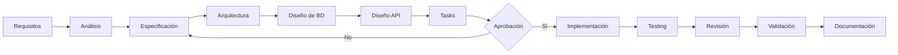

## Tabla de contenidos

- [Conceptos: agents, skills, specs y tasks](#conceptos-agents-skills-specs-y-tasks)
- [Flujo SDD obligatorio](#flujo-sdd-obligatorio)
- [Guía para futuros desarrollos](#guía-para-futuros-desarrollos)
- [Reglas irreductibles](#reglas-irreductibles)
- [Punto de entrada rápido](#punto-de-entrada-rápido)
- [Documentación relacionada](#documentación-relacionada)

## Conceptos: agents, skills, specs y tasks

| Concepto | Qué es | Dónde vive |
|---|---|---|
| **Agent** | QUIÉN realiza el trabajo (rol y responsabilidades). | `agents/` |
| **Skill** | CÓMO se realiza determinado trabajo (conocimiento reutilizable). | `skills/` |
| **Spec** | QUÉ se debe construir. | `projects/<p>/specs/` |
| **Project** | DÓNDE se define el trabajo. | `projects/<p>/` |
| **Task** | QUÉ unidad concreta ejecutar. | `projects/<p>/tasks/<ID>.md` |
| **Validation** | CÓMO verificamos que está correcto. | `projects/<p>/validation/validation.md` |
| **Docs** | VERDAD arquitectónica de referencia. | `docs/architecture/` |
| **History** | MEMORIA técnica de la IA. | `docs/history/` (un fichero por cambio) |
| **ChangeLog** | RESUMEN divulgativo para blog. | `docs/change_logs/` |

Los Agents **no** contienen conocimiento técnico procedural (vive en `skills/`); las Skills **no** definen roles. Cada cosa en su carpeta. Detalle: `agents/README.md`, `skills/README.md`, `projects/README.md`.

| Agent | Responsabilidad |
|---|---|
| [architect](agents/architect/instructions.md) | Requisitos, specs y arquitectura SDD (no programa). |
| [developer](agents/developer/instructions.md) | Implementar tareas o fixes. |
| [reviewer](agents/reviewer/instructions.md) | Revisar código contra spec, arquitectura y seguridad. |
| [debugger](agents/debugger/instructions.md) | Diagnosticar errores (causa raíz + corrección mínima). |
| [database](agents/database/instructions.md) | Tablas, índices, consultas, transacciones. |
| [documentation](agents/documentation/instructions.md) | Docs de arquitectura, módulos, PHPDoc y decisiones. |
| [tester](agents/tester/instructions.md) | Crear o ampliar suites de pruebas de un módulo. |
| [security](agents/security/instructions.md) | Auditoría / hardening de seguridad (solo lectura). |
| [frontend](agents/frontend/instructions.md) | Vistas, maquetación, widgets y responsive. |
| [triage](agents/triage/instructions.md) | Clasificar y enrutar la petición; verificar el registro al cierre. |

Subagentes invocables: `.opencode/agents/<x>.md` y `.claude/agents/<x>.md` (envoltorios que remiten a `agents/<x>/instructions.md`).

---

## Flujo SDD obligatorio

Puerta de aprobación antes de implementar:



No se implementa con requisitos/specs insuficientemente definidos ni sin spec aprobada. Plantilla de proyecto y de task en `projects/README.md`; ejemplo completo en `projects/example/` (reservas de vehículos, árbol de tasks atómicas). Las tasks se descomponen recursivamente hasta que no admiten más división (ADR-0006); cada task en su propio archivo (ADR-0009). El árbol estándar de cada tipo de transacción está en `docs/architecture/sdd/recipe-<tipo>.md`.

---

## Guía para futuros desarrollos

("Crear un nuevo módulo de X")

```text
1.  Leer docs/architecture/README.md (mapa) y los archivos que indique
2.  Analizar módulos existentes → identificar el más parecido (fuente de verdad)
3.  Architect Agent → requirements/requirements.md (RF-XXX)
4.  Architect Agent → specs/{functional,technical,database,api,security}.md
5.  Architect + Database → architecture/architecture.md (módulo de referencia,
    patrones a reutilizar, elementos que NO copiarse)
6.  Database Agent → specs/database.md (tablas + índices justificados)
7.  Architect → tasks/<ID>.md (un archivo por task): árbol desde docs/architecture/sdd/recipe-<tipo>.md
    (hojas con 1 archivo, 1 agent, 1 criterio, Receta, Contexto mínimo, Valores, dependencias, estado)
8.  APROBACIÓN de la spec  ← puerta obligatoria
9.  Developer Agent + skills/{transactions,php,frontend,mysql,api} → implementar hoja a hoja (Receta + Valores)
10. Testing → validation/validation.md (matriz de endpoints)
11. Reviewer Agent → hallazgos en validation/validation.md
12. Documentation Agent → README del módulo + docs/architecture actualizados
13. Cerrar checklist de validation/validation.md
```

---

## Reglas irreductibles

- **No inventar arquitectura** si existe funcionalidad: antes de crear un archivo, verificar si hay un patrón equivalente y usarlo (flujo de reutilización en `docs/architecture/patterns/reuse-flow.md`).
- **No** introducir Node.js/npm/Composer/frameworks nuevos ni dependencias sin justificación (los SDK de `vendors/libs/` se instalan por driver, no para la app).
- **No** modificar `vendors/fatfree/` ni el núcleo `vendors/application/` sin justificación aprobada.
- **No** refactorizar código no relacionado con el requerimiento.
- **No** copiar código sin analizarlo: función equivalente → reutilizar; patrón equivalente → seguir; si no, diseñar y documentar la decisión en `architecture.md` del proyecto.
- Antes de modificar código existente: archivo → dependencias → consumidores → impacto → comportamiento actual → compatibilidad → modificar → validar regresiones.
- Antes de tocar BD: 10 pasos de `skills/mysql/SKILL.md` §Procedimiento (Diseño de tablas) (rol en `agents/database/instructions.md`); cada índice justificado por una consulta real (`idx_<tabla>_<cols>`, `uk_<tabla>_<cols>`).
- Cada endpoint define: Método | Ruta | Auth | Permiso (`idLevelLimit` 1 Ver / 2 Editar / 3 Crear / 4 Borrar) | Params | Validaciones | Request | Response | Errores | Códigos | Transacción.
- Seguridad: solo mecanismos existentes (`SessionService`, `PermissionService`, `CsrfToken`, `ScopeAccess`, `CheckData`, prepared statements, IDs cifrados AES-256-CBC, `RateLimiter`, `BruteForceService`, `AuditLogger`) salvo decisión documentada.
- Todo cambio relevante deja **doble traza inmutable**: `docs/history/YYYY-MM-DD_<slug>--<agente>.md` (memoria técnica) + `docs/change_logs/YYYYMMDD-<slug>.md` (post blog). Prohibido editar ficheros ya creados sin confirmación explícita (corrección = fichero nuevo que referencie al anterior). Norma completa: `agents/README.md` §Protocolo de registro.

---

## Punto de entrada rápido

- ¿Qué se carga al principio? → `AGENTS.md` §0 paso 1: `skills/caveman/SKILL.md` (modo de respuesta) + `skills/boost-prompt/SKILL.md` (refinar la petición si es ambigua o SDD).
- ¿Cuánto abarca esta petición? → `AGENTS.md` §1 (puntual = solo lo pedido, sin tocar `projects/`; SDD = flujo completo).
- ¿Qué tareas hay pendientes? → `AGENTS.md` §2 (grep canónico) + `docs/history/PENDIENTES.md`.
- ¿Qué se decidió antes sobre X? → `docs/history/DECISIONES.md` + `docs/history/INDEX.md`.
- ¿Auditar arquitectura? → `docs/architecture/README.md` (mapa) + `docs/architecture/core/`.
- ¿Crear o modificar una transacción de tipo X? → `skills/transactions/SKILL.md` + `docs/architecture/transactions/README.md`.
- ¿Exportar a Excel o verificar una exportación? → `skills/excel/SKILL.md` + `docs/architecture/ui/export-excel.md`.
- ¿Crear especificación? → `agents/architect/instructions.md` + `skills/sdd/SKILL.md`.
- ¿Implementar? → `agents/developer/instructions.md` + `skills/transactions|php|mysql|api/SKILL.md`.
- ¿Tocar BD? → `agents/database/instructions.md` + `skills/mysql/SKILL.md`.
- ¿Revisar / depurar? → `agents/reviewer|debugger/instructions.md` + `skills/review|testing|debugging/SKILL.md`.
- ¿No sé qué agent usar? → `agents/triage/instructions.md` (clasifica y enruta).
- ¿Crear pruebas? → `agents/tester/instructions.md` + `skills/testing/SKILL.md`.
- ¿Auditar seguridad? → `agents/security/instructions.md` + `skills/security-audit/SKILL.md`.
- ¿Cambiar una pantalla? → `agents/frontend/instructions.md` + `skills/frontend/SKILL.md`.
- ¿Por qué se decidió X a nivel de arquitectura? → `docs/architecture/decisions/` (ADR).
- ¿Documentar un cambio? → `agents/documentation/instructions.md` + `docs/history/README.md` + `docs/change_logs/README.md`.
- ¿Ver ejemplo completo? → `projects/example/` (README + requirements + specs + architecture + tasks + validation).
- ¿Subidas de archivos? → `vendors/application/storage/README.md` (drivers Local/S3/GCS/SFTP).

---

## Documentación relacionada

- [README.md](README.md) — visión general, demo, SDD y reglas.
- [AGENTES.md](AGENTES.md) — agents, skills, specs y tasks.
- [ARCHITECTURE.md](ARCHITECTURE.md) — arquitectura, componentes de seguridad y capa de datos.
- [DATABASE.md](DATABASE.md) — modelo de datos y diagrama ER.
- [FEATURES.md](FEATURES.md) — funcionalidades y módulos con capturas.
- [INSTALLATION.md](INSTALLATION.md) — requisitos, instalación y configuración.
- [OPERATIONS.md](OPERATIONS.md) — escalabilidad, cambios, backups y DRP.
- [SECURITY.md](SECURITY.md) — modelo de seguridad, permisos y niveles de acceso.
