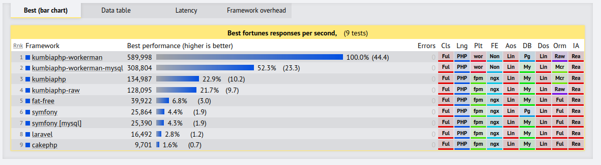
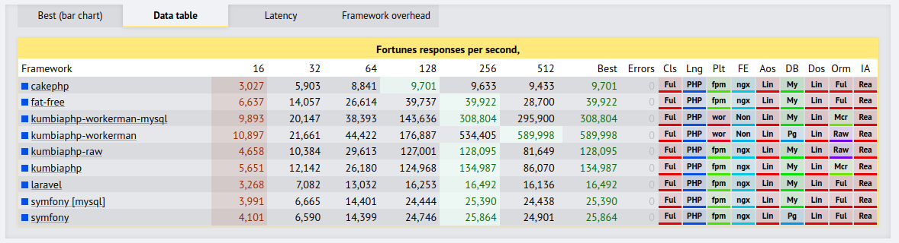
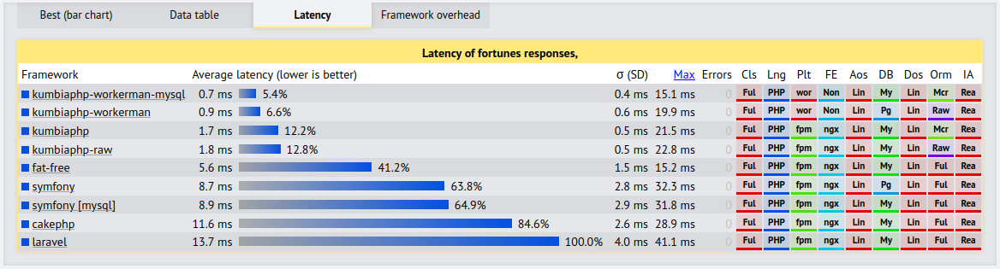
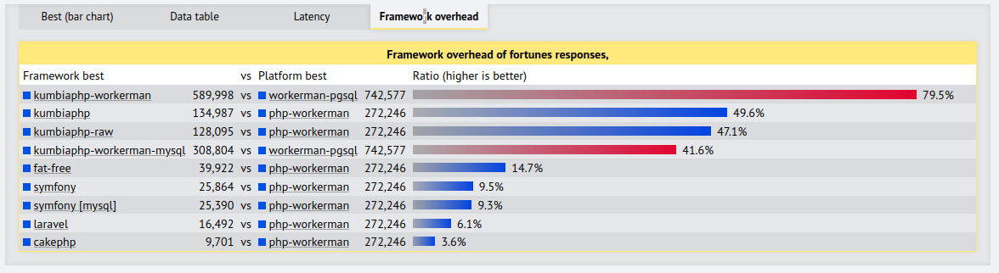
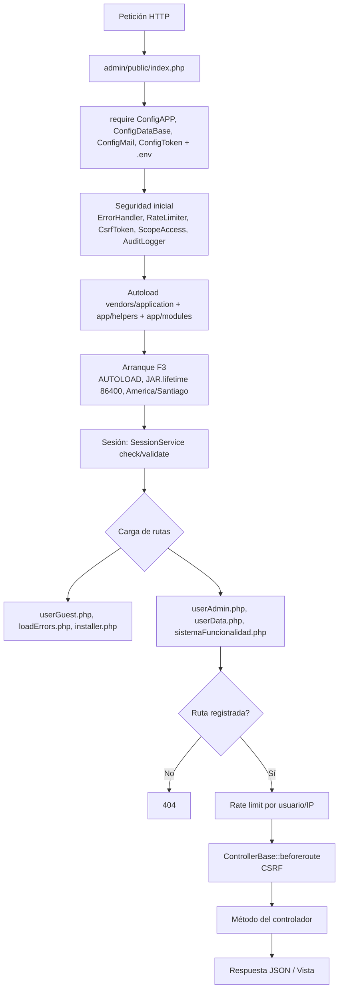

# Arquitectura de coreEngine

Documento público de arquitectura. La **verdad interna** que usan los agentes vive en `docs/architecture/` (mapa en `docs/architecture/README.md`); este documento resume y enlaza esa verdad para lectores humanos.

---

## Tabla de contenidos

- [Visión general](#visión-general)
- [Principios de diseño](#principios-de-diseño)
- [Stack tecnológico](#stack-tecnológico)
- [¿Por qué Fat-Free Framework?](#por-qué-fat-free-framework)
- [Patrones de arquitectura](#patrones-de-arquitectura)
- [Estructura del repositorio](#estructura-del-repositorio)
- [Estructura de un módulo](#estructura-de-un-módulo)
- [Flujo de una petición](#flujo-de-una-petición)
- [Tipos de transacción](#tipos-de-transacción)
- [Componentes de la aplicación](#componentes-de-la-aplicación)
- [Tecnologías frontend](#tecnologías-frontend)
- [Tecnologías backend](#tecnologías-backend)
- [Escalabilidad](#escalabilidad)
- [Reglas de integración](#reglas-de-integración)

---

## Visión general

coreEngine es una plataforma **multi-sitio** en **PHP 8** sobre **Fat-Free Framework (F3)** con persistencia **MySQL** vía PDO (driver `DB\SQL` de F3).

- **Monolito modular:** un núcleo compartido (`vendors/application/`) y módulos autocontenidos (`admin/app/modules/<modulo>/`).
- **Backoffice + sitios públicos:** `admin/` y `sites_*/` comparten el mismo núcleo y los mismos patrones.
- **Sin Composer en la aplicación:** el autoload lo arma el bootstrap con la variable `AUTOLOAD` de F3. La única excepción son las librerías Office vendorizadas en `vendors/libs/` (cada una con su `vendor/` y `composer.lock`).
- **Estilo MVC modular-monolítico:** cada módulo contiene sus controladores, vistas e installer. Modelo lógico: `controller/`, `installer/` y `functions/` opcional; vista: `views/`; controlador: clase que extiende `ControllerBase`.

---

## Principios de diseño

- **Arquitectura Screaming:** la estructura del proyecto grita sus casos de uso; cada módulo es independiente y se puede instalar, actualizar o desinstalar.
- **SOLID, DRY y KISS:** código limpio, mantenible y extensible; se reutiliza antes de copiar.
- **Separación de preocupaciones:** el motor de plantillas nativo de F3 desacopla la lógica de negocio de la presentación. Se puede cambiar la biblioteca visual (por ejemplo, de Bootstrap a Tailwind) sin comprometer la funcionalidad.
- **No inventar arquitectura:** si existe un patrón funcional equivalente, se reutiliza (`docs/architecture/patterns/reuse-flow.md`).
- **Seguridad por diseño:** los mecanismos existentes son la única vía salvo decisión documentada (ADR).

---

## Stack tecnológico

| Tecnologia | Stack |
|---|---|
| Backend | PHP 8 + F3 (vendors/fatfree, bcosca/fatfree-core, sin Composer para la app; AUTOLOAD F3) |
| BD | MySQL (PDO vía DB\SQL de F3) + SQLite/Mongo/Jig/PostgreSQL opcionales vía Database |
| Frontend | Bootstrap 5 + bootstrap-icons/remixicon/boxicons, jQuery 3.7, SweetAlert2, Select2, FullCalendar, ApexCharts/Chart.js/ECharts/Plotly, Leaflet, JS propio (admin/public/js/functions_v2.js, form_functions.js, main.js) |
| Upload | FileManager multi-driver (Local/S3/GCS/SFTP) en vendors/application/storage/ + SDKs en vendors/libs/ (aws-sdk, gcs-sdk, sftp-sdk/phpseclib, php-ai-sdk, phpdotenv, php-jwt, PhpSpreadsheet, PHPWord, PHPPresentation, predis, php-ml) |
| Seguridad | SessionService + CsrfToken + ScopeAccess + RateLimiter + AuditLogger + ErrorHandler + BruteForceService + CheckData + QueryBuilder (prepared statements) |
| Arranque | admin/public/index.php + sites_*/public/index.php | Zona: America/Santiago |

| Componente | Tecnología | Propósito |
|---|---|---|
| **Backend / lógica** | Fat-Free Framework (F3) | Micro-framework PHP ligero. |
| **Base de datos** | MySQL 5.7+ / MariaDB 10.3+ | ORM nativo de F3; portabilidad a PostgreSQL, SQLite, MongoDB, Jig y Redis. |
| **Interfaz gráfica** | Bootstrap 5, Glyphicons, Boxicons, Remixicon | Componentes visuales y frontend responsivo. |
| **Funcionalidad frontend** | jQuery, SweetAlert2, Select2, Chart.js, ApexCharts, ECharts, Plotly.js, FullCalendar, Leaflet, Material-Picker | Interactividad, notificaciones y visualización de datos. |
| **Runtime** | PHP 8.4 (`lamp-php84`, 8.4.27) | La exportación `.xlsx` usa PhpSpreadsheet 5.11.0 y exige PHP ≥ 8.3. |
| **Servidor web** | Apache 2.4+ o Nginx | `mod_rewrite` habilitado; `.htaccess` incluidos. |

### Extensiones PHP

- Base: `pdo`, `pdo_mysql`, `json`, `mbstring`, `openssl`, `curl`, `gd`, `fileinfo`.
- Exportación a Excel (`FunctionsExportExcel::missingExtensions()`): `ctype`, `dom`, `fileinfo`, `filter`, `iconv`, `libxml`, `mbstring`, `simplexml`, `xml`, `xmlreader`, `xmlwriter`, `zip`, `zlib`.

### Librerías Office vendorizadas

- `vendors/libs/PhpSpreadsheet` **5.11.0** (reference `3aa1f0d`): exportación `.xlsx` en servidor (ADR-0021). Carga con `require 'vendors/libs/PhpSpreadsheet/vendor/autoload.php'`.
- `vendors/libs/PHPWord` **1.4.0** (+ `phpoffice/math 0.3.0`): documentos de texto.
- `vendors/libs/PHPPresentation` **1.2.0** (+ `phpoffice/common 1.1.0` y su propia `phpspreadsheet 4.5.0`): presentaciones.
- Son la única excepción a "sin Composer": `vendor/` y `composer.lock` van versionados; no se ejecuta Composer en la aplicación.

---

## ¿Por qué Fat-Free Framework?

Porque es el framework más limpio disponible y uno de los que tiene el mejor benchmark frente a otros frameworks populares. Existe otro aún más rápido llamado Kumbia, pero implementa su propia forma de organizar sus componentes y es demasiado restrictivo, lo que impide la reutilización de componentes y funciones.

**Benchmarks — respuestas por segundo:**





**Latencia:**



**Sobrecarga:**



---

## Patrones de arquitectura

### Screaming Architecture

La estructura del proyecto prioriza la **modularidad** y la fácil instalación de nuevos componentes (plugins o módulos). Cada módulo es independiente y sigue el patrón de diseño **Modelo-Vista-Controlador (MVC)**; gracias a su modularidad puede usar cualquier otro patrón.

### MVC y arquitectura de tres niveles

Según el módulo y la pantalla, la implementación se apoya en **tres niveles**:

1. **Presentación:** vistas `views/` renderizadas con el motor de plantillas de F3.
2. **Controlador:** clases que extienden `ControllerBase` y exponen métodos enrutados por F3.
3. **Datos:** `Base_*` / `QueryBuilder` sobre MySQL (prepared statements).

### Separación de preocupaciones y reutilización

- El motor de plantillas nativo de F3 desacopla lógica y presentación.
- Las bibliotecas internas estandarizan fechas, horas, montos financieros, validaciones, notificaciones y mailing.
- La lógica compartida dentro de un módulo vive en `functions/`; la compartida entre módulos o sitios vive en `vendors/application/functions/` solo con ADR.

---

## Estructura del repositorio

```text
coreEngine/
├── admin/                     # Backoffice
│   ├── app/
│   │   ├── config/            # ConfigAPP, ConfigDataBase, ConfigMail, ConfigToken, .env, EnvLoader
│   │   ├── helpers/           # Servicios transversales (*Service, UserRepository)
│   │   ├── modules/           # Un directorio por módulo
│   │   ├── templates/         # Plantillas globales (header/footer, impresión, mail, widgets)
│   │   └── utils/             # Rutas fijas F3 (userAdmin, userData, userGuest, installer, ...)
│   ├── public/
│   │   ├── css/               # Hojas de estilo
│   │   ├── img/               # Imágenes del backoffice
│   │   ├── js/                # functions_v2.js, form_functions.js, main.js, jQuery
│   │   ├── security/          # Rate limit persistido (JSON)
│   │   ├── upload/            # Archivos subidos por usuarios
│   │   ├── vendor/            # Librerías frontend
│   │   ├── index.php          # Bootstrap
│   │   ├── robots.txt
│   │   └── .htaccess
│   └── security/              # Logs y rate limit del backoffice
├── vendors/
│   ├── fatfree/               # Framework F3 (terceros, NO modificar)
│   ├── application/
│   │   ├── controller/        # ControllerBase, ControllerFiles, ControllerInstaller, ControllerWeb
│   │   ├── models/            # QueryBuilder, CheckData, MailSender, TemplateRenderer, FileManager, ...
│   │   ├── functions/         # Functions* (validación, seguridad, fechas...), UI* (widgets)
│   │   ├── security/          # ErrorHandler, RateLimiter, AuditLogger, CsrfToken, ScopeAccess
│   │   ├── storage/           # Drivers de almacenamiento (Local, S3, GCS, SFTP)
│   │   └── utils/             # Database, Request, Response
│   └── libs/                  # SDKs vendorizados
├── sites_*/                   # Sitios públicos (misma estructura app/public/security)
├── agents/                    # Roles de IA
├── skills/                    # Conocimiento procedural
├── projects/                  # Proyectos SDD
├── docs/
│   ├── architecture/          # Verdad arquitectónica interna y ADR
│   ├── history/               # Memoria técnica por cambio
│   └── change_logs/           # Posts divulgativos por cambio
├── src/                       # Capturas usadas en la documentación
├── AGENTS.md
├── CLAUDE.md
└── README.md
```

### Módulos sin installer

Tienen rutas fijas en `admin/app/utils/`: `main`, `root_maquetacion`, `root_plataforma`, `installer`.

---

## Estructura de un módulo

```text
admin/app/modules/<modulo>/
├── README.md        # documentación del módulo
├── mcp.php          # opcional: manifiesto MCP (ADR-0011)
├── controller/      # <entidad>Listado.php → class <entidad>Listado extends ControllerBase
├── views/           # <controlador>-<Sufijo>.php
├── installer/       # <modulo>Installer.php → class <modulo>Installer extends ControllerInstaller
├── testing/         # <controlador>Testing.php, uno por controlador
├── widgets/         # <modulo>Widgets.php + widgets-<tema>.php + widgets-<tema>-update.php
├── functions/       # Internal<Fn><Modulo>.php (helpers internos, sin BD ni rutas)
└── .htaccess        # deny from all en cada carpeta
```

| Carpeta / archivo | Obligatorio | Regla |
|---|---|---|
| `controller/` | Sí | Al menos un controlador. Extiende `ControllerBase`, o `ControllerFiles` si no usa BD. |
| `views/` | Sí | Una vista por acción que renderiza HTML. Sufijos: `-List`, `-UpdateList`, `-View`, `-Resumen`, `-formNew`, `-formEdit`, `-formSearch`, `-Print`. |
| `installer/` | Sí, si crea tablas o permisos | Tablas, índices, semillas, permisos y rutas. |
| `testing/` | Sí, en módulos con installer | Un `<controlador>Testing.php` por controlador. |
| `widgets/` | No | Solo si el módulo expone widgets de dashboard. |
| `functions/` | No | Helpers internos del módulo. |
| `mcp.php` | No | Manifiesto opcional de exposición para el servidor MCP (formato cerrado, falla cerrado si es inválido). |
| `README.md` | Recomendado | Estructura, tablas, rutas y dependencias del módulo. |

### Ejemplo real: `admin/app/modules/bodegas/`

```text
controller/  bodegasListado.php                 CRUD principal con ficha (Resumen)
             bodegasListadoObservaciones.php    Sub-entidad fragmento
             bodegasListadoZonas.php, ...Pasillos.php, ...Racks.php, ...Distribucion.php
                                                Sub-controladores con permisos del padre
             bodegasMovimiento.php              Wrappers _1/_2/_3 + createMov/removeMov
             bodegasMovimientoProductos.php     insertMov/updateMov/deleteMov
             informeProductos.php               Informe de solo lectura + Print
views/       bodegasListado-{List,UpdateList,View,Resumen,Resumen-Update,formNew,formSearch}.php
             bodegasListado-Resumen-Observaciones-{UpdateList,View,formNew,formEdit}.php
             bodegasListadoZonas-*.php, bodegasMovimiento-*.php, informeProductos-*.php
             common-Print.php
installer/   bodegasInstaller.php               listTables, optimizeTables, seedCatalogs, getRouteDefinitions
testing/     <controlador>Testing.php por cada controlador
widgets/     bodegasWidgets.php, widgets-stock.php, widgets-stock-update.php
```

---

## Flujo de una petición



| # | Paso | Detalle |
|---|---|---|
| 1 | Configuración | `require` de `ConfigAPP`, `ConfigDataBase`, `ConfigMail`, `ConfigToken`; `.env` vía `EnvLoader`. |
| 2 | Seguridad inicial | Whitelist de IPs dev, `ErrorHandler::register()`, carga de `RateLimiter`, `CsrfToken`, `ScopeAccess`, `AuditLogger`. |
| 3 | Autoload | `vendors/application/` (`controller/`, `models/`, `utils/`, `functions/`), `app/helpers/` y, por cada carpeta de `app/modules/`: `controller/`, `installer/`, `testing/`, `widgets/`, `functions/`. |
| 4 | Arranque F3 | `AUTOLOAD`, `JAR.lifetime = 86400`, zona horaria `America/Santiago`. |
| 5 | Sesión | `SessionService` (`check` / `validate`) contra BD y cookie `Sesion_tk`. |
| 6 | Rutas | Ver tabla siguiente. |
| 7 | Rate limit | `RateLimiter::isBlockedByUser` (con sesión) o `isBlockedByIp` → HTTP 429. |
| 8 | Ejecución | `$f3->run()`. |

### Archivos de rutas cargados

| Condición | Archivos de `admin/app/utils/` |
|---|---|
| Sesión activa y `SESSION.DataInfo.PasswordForzarCambio == 1` | Solo `userPasswordForzada.php` (Mi Usuario + logout). |
| Sesión activa normal | `userAdmin.php` (sus rutas exigen `SESSION.DataInfo.UserType == 1`), `userData.php`, `sistemaFuncionalidad.php`. |
| Siempre | `userGuest.php`, `loadErrors.php`, `installer.php`. |

`userData.php` registra `GET /principal`, los endpoints de widgets, incluye `userMiUsuario.php` y registra las rutas por permiso desde `SESSION.arrPermisos`.

### Antes de llegar al método del controlador

1. F3 resuelve la ruta → instancia el controlador (constructor con conexión BD).
2. `beforeroute()` de `ControllerBase` / `ControllerFiles` ejecuta `CsrfToken::guard($f3)`.
3. Se ejecuta el método enrutado.

### Diagnóstico rápido

- 404 o página vacía: la ruta no está en `app/utils/*.php` ni en `SESSION.arrPermisos` (permiso no asignado o módulo no instalado).
- Resto de códigos HTTP (400, 405, 409, 419, 429, 500): `docs/architecture/api/response.md`.

---

## Tipos de transacción

| Tipo | Qué es | `idTipo` del permiso | Referencia |
|---|---|---|---|
| CRUD Normal | Catálogo simple: lista + modales de alta/edición | 1 | `admin/app/modules/entidades/controller/entidadesSectores.php` |
| CRUD Resumen | Ficha con pestañas (`/resumen/@id`), sub-entidades y archivos | 2 | `admin/app/modules/bodegas/controller/bodegasListado.php` |
| Informe | Solo lectura: filtros + tabla + detalle/impresión | 3 | `admin/app/modules/bodegas/controller/informeProductos.php`, `admin/app/modules/root_plataforma/controller/crudInforme.php` |
| Installer | Tablas, índices, semillas, permisos y rutas del módulo | — | `admin/app/modules/bodegas/installer/bodegasInstaller.php` |
| Widgets | Bloques de la pantalla principal (`/principal`) | — | `admin/app/modules/campanas/widgets/gestionCampanasWidgets.php` |

Regla: no mezclar métodos entre tipos. Detalle y métodos prohibidos: `docs/architecture/transactions/README.md`.

---

## Componentes de la aplicación

Carpetas de `admin/app/` que no son módulos de negocio pero forman parte del esqueleto:

| Carpeta | Propósito | Archivos destacados |
|---|---|---|
| `apis/` | Lógica de resolución de las APIs integradas en la plataforma. | `apiSession/` |
| `config/` | Configuración general de la plataforma. | `ConfigAPP.php`, `ConfigDataBase.php`, `ConfigMail.php`, `ConfigToken.php`, `.env`, `EnvLoader.php` |
| `crones/` | Manejo de los crones de la plataforma. | `cronList/` |
| `helpers/` | Sesiones, autenticación, permisos y servicios de usuario. | `SessionService`, `AuthenticationService`, `PermissionService`, `PasswordService`, `BruteForceService`, `MailService`, `UserRepository`, `UserSessionDataService`, `WidgetsOrderService` |
| `templates/` | Plantillas de la interfaz; permite cambiar de framework CSS. | `Forms/`, `Mail/`, `Widgets/`, `api-view.php`, `guest-header.php`, `guest-footer.php`, `pages-error404.php` |
| `utils/` | Rutas fijas F3 y utilidades de arranque. | `userAdmin.php`, `userData.php`, `userGuest.php`, `userMiUsuario.php`, `userPasswordForzada.php`, `sistemaFuncionalidad.php`, `installer.php`, `loadErrors.php` |

---

## Tecnologías frontend

Bibliotecas servidas desde `admin/public/vendor/` (sin npm). **No añadir otras.**

| Librería | Descripción breve |
|---|---|
| **PDFObject** | Script JS para incrustar documentos PDF en páginas HTML mediante HTML5. |
| **ViewerJS** | Visor de documentos en línea (PDF, OpenDocument) renderizados en HTML5/JS sin plugins externos. |
| **aos (Animate On Scroll)** | Animaciones desencadenadas al hacer scroll. |
| **apexcharts** | Gráficos vectoriales interactivos y dashboards en tiempo real. |
| **audio_player** | Reproductor multimedia HTML5 estilizado para audio local o remoto. |
| **autosize** | Autoajuste de la altura de `<textarea>` según el texto. |
| **bootstrap** | Framework CSS/JS responsivo (Bootstrap 5), base de la UI. |
| **bootstrap-icons** | Iconos vectoriales oficiales de Bootstrap. |
| **bootstrap_colorpicker** | Selector de color integrado con inputs de Bootstrap. |
| **bootstrap_fileinput** | Subida de archivos con vista previa, drag & drop y barra de progreso. |
| **bootstrap_touchspin** | Spinner numérico con botones incrementales/decrementales. |
| **boxicons** | Colección de iconos vectoriales para interfaces modernas. |
| **chart.js** | Gráficos estadísticos sobre HTML5 Canvas (barras, líneas, dona, etc.). |
| **clock_timepicker** | Selector de horas con reloj analógico interactivo. |
| **echarts** | Apache ECharts: visualización de datos de alto rendimiento. |
| **form_validator** | Validación de formularios en el cliente. |
| **fullcalendar** | Calendario interactivo para agendas, reservas, citas y eventos. |
| **glyphicons** | Iconos tipográficos clásicos. |
| **jstree** | Árbol jerárquico interactivo sobre jQuery. |
| **leaflet** | Mapas interactivos georreferenciados. |
| **material_datetimepicker** | Selector de fecha y hora con estética Material Design. |
| **mejs-player** | MediaElement.js: reproductor universal HTML5 de audio y video. |
| **meteo** | Widget de datos climáticos e informes meteorológicos. |
| **php-email-form** | Envío AJAX de formularios de contacto con feedback de estado. |
| **plotly_js** | Gráficos científicos y analíticos avanzados. |
| **popover-ex** | Extensión de los popovers de Bootstrap. |
| **printerDocs** | Impresión de documentos y reportes con formato limpio. |
| **prism** | Resaltador de sintaxis para bloques de código. |
| **radio_player** | Reproductor de streaming de radio y audio continuo. |
| **remixicon** | Iconos vectoriales neutros y elegantes. |
| **rss_reader** | Lector cliente de noticias RSS/Atom. |
| **rut_validate** | Validador y formateador del RUT/RUN chileno. |
| **select2** | Select avanzado con búsqueda, selección múltiple y AJAX. |
| **simple-datatables** | Tablas HTML ordenables, paginadas y con buscador, sin jQuery. |
| **sweetalert2** | Alertas y confirmaciones estilizadas (`Swal.fire`). |
| **tinymce** | Editor de texto enriquecido WYSIWYG. |
| **upload_and_crop_image** | Subida, recorte y previsualización de imágenes. |

### Reglas de maquetación

- Grid de Bootstrap (`row` / `col-md-*`). En escritorio las columnas son fijas; en móvil Bootstrap las apila.
- No usar anchos en píxeles para el layout.
- Widgets del dashboard: el descubrimiento y orden los gestiona `admin/app/helpers/WidgetsOrderService.php`.
- Permisos en la UI: acciones condicionadas en PHP con `$data['UserAccess']['LevelAccess']` (≥2 editar, ≥3 crear, ≥4 borrar).

Detalle: `docs/architecture/ui/libs.md`.

---

## Tecnologías backend

### Controladores (`vendors/application/controller`)

| Archivo | Descripción breve |
|---|---|
| **`ControllerBase.php`** | Clase base para controladores con BD. Proporciona `Base_GetList/GetByID/GetCountData/insert/insertMultiple/update/delete/delFiles/queryExecute`, transacciones, `lockRowsForUpdate`, `showVista/showError`, `searchWhere`, `getArrLevel`, `getUserData`, `isValidDecrypted`, `mergeResponses`. `beforeroute()` aplica `CsrfToken::guard()`. |
| **`ControllerFiles.php`** | Base **sin BD** para controladores que solo renderizan (`archivosListado`): `beforeroute` (CSRF), `getUserData`, `getArrLevel`, `returnRutaVista`, `showVista`, `showError`. |
| **`ControllerInstaller.php`** | Base de installers: `Base_GetList/GetCountData/insert`, transacciones, `Base_queryExecute`, `Base_createTable`, `Base_dropTable`, `Base_installModule`, `Base_uninstallModule`, `Base_getCountDataModule`. |
| **`ControllerWeb.php`** | Base de controladores de los sitios `sites_*`; `beforeroute()` valida CSRF (ADR-0007). |

### Funciones helper (`vendors/application/functions`)

| Archivo | Descripción breve |
|---|---|
| **`FunctionsCommonData.php`** | Utilidades comunes: agrupación por clave, conversión recursiva de objetos, análisis de rutas y `safePath`. |
| **`FunctionsConvertions.php`** | Conversión de formatos, transformaciones de unidades y codificaciones. |
| **`FunctionsDataDate.php`** | Fechas: formateo, diferencias, días laborables y calendarios. |
| **`FunctionsDataNumbers.php`** | Montos, moneda (CLP, USD), porcentajes y operaciones matemáticas. |
| **`FunctionsDataOperations.php`** | Operaciones lógicas y procesamiento de arreglos complejos. |
| **`FunctionsDataSQL.php`** | Fragmentos SQL, cláusulas de consulta y sanitización de términos. |
| **`FunctionsDataText.php`** | Texto: limpieza, slugs y truncado. |
| **`FunctionsDataTime.php`** | Horas, minutos, segundos, timestamps y conversiones. |
| **`FunctionsDataValidations.php`** | Validación de datos: RUT chileno, emails, teléfonos y tipos. |
| **`FunctionsLocation.php`** | Coordenadas geográficas, distancias y estructura territorial (regiones/comunas). |
| **`FunctionsSecurityCodification.php`** | Cifrado, descifrado, hashes y codificación (Base64, etc.). |
| **`FunctionsSecurityPasswords.php`** | Generación y verificación de contraseñas con Bcrypt/Argon2. |
| **`FunctionsServerClient.php`** | Metadatos del cliente: IP, navegador, sistema operativo y User-Agent. |
| **`FunctionsServerIA.php`** | Comunicación con servicios de Inteligencia Artificial. |
| **`FunctionsServerSecurity.php`** | Seguridad del servidor, fuerza bruta y baneos por IP. |
| **`FunctionsServerServer.php`** | Estado del servidor: memoria, almacenamiento, variables globales y entorno PHP. |
| **`FunctionsServerSocial.php`** | Metadatos para plataformas sociales (Facebook, X, Instagram, LinkedIn). |
| **`FunctionsServerWeb.php`** | Peticiones HTTP, cabeceras, cURL y respuestas JSON. |
| **`UIFormInputs.php`** | Generación dinámica de inputs HTML5 con estilos preconfigurados. |
| **`UIWidgetsCommon.php`** | Componentes de interfaz comunes: tarjetas, botones, estados, alertas y modales. |
| **`UIWidgetsGraphics.php`** | Inicialización de gráficos e indicadores de dashboard. |
| **`UIWidgetsMaps.php`** | Mapas interactivos y marcadores con Leaflet. |

### Modelos y utilidades (`vendors/application/models` + `vendors/application/utils`)

| Archivo | Descripción breve |
|---|---|
| **`CheckData.php`** | Validación de reglas de negocio, campos requeridos, unicidad y formatos antes de operar sobre la BD. |
| **`QueryBuilder.php`** | Construcción y ejecución de SQL desde arrays con prepared statements (selects, inserts, updates, deletes y creación de tablas). |
| **`FileManager.php`** | Fachada de almacenamiento multi-driver (Local, S3, GCS, SFTP): validar, subir, descargar, renombrar y borrar. |
| **`ImageManager.php`** | Redimensionado, recorte, optimización y conversión de imágenes. |
| **`MailSender.php`** | Plantillas y envío de correos por SMTP, Gmail o Sendinblue/Brevo. |
| **`TemplateRenderer.php`** | Renderizado de plantillas HTML y componentes visuales con parámetros dinámicos. |
| **`FilePolicy`, `FilePathGuard`, `FileInspector`, `FileUploader`, `FileExplorer`** | Política de tipos, anti path-traversal, MIME real, subida y explorador. |
| **`Database.php`** | Fábrica estática de conexiones (`getSQLConnection`, SQLite, Mongo, Jig). Vive en `vendors/application/utils/`. |
| **`Response.php`** | Respuestas JSON. Vive en `vendors/application/utils/`. |

### Librerías y SDKs externos (`vendors/libs`)

| Directorio / SDK | Descripción breve |
|---|---|
| **`PHPPresentation`** | Creación y exportación de presentaciones PowerPoint/OpenXML. |
| **`PHPWord`** | Creación y modificación de documentos DOCX, ODT y RTF. |
| **`PhpSpreadsheet`** | Lectura, escritura y manipulación de Excel XLSX y CSV. |
| **`aws-sdk`** | SDK oficial de AWS para S3 y servicios Cloud. |
| **`gcs-sdk`** | SDK de Google Cloud Storage para buckets y objetos. |
| **`php-ai-sdk`** | Conexión con APIs de proveedores de Inteligencia Artificial (LLM). |
| **`php-jwt`** | Generación, firma, decodificación y verificación de JWT. |
| **`predis`** | Cliente PHP para Redis (caché y datos en memoria). |
| **`sftp-sdk`** | Conexiones SSH2 y transferencia segura por SFTP (`phpseclib`). |
| **`php-ml`** | Machine learning en PHP (informes predictivos, ADR-0020). |
| **`phpdotenv`** | Carga de variables de entorno desde `.env`. |

---

## Escalabilidad

Resumen: la arquitectura ligera de F3 mantiene un consumo bajo (~1-2 MB por petición) y permite escalar en cuatro fases: almacenamiento stateless en S3/GCS + CDN, sesiones y caché en Redis, réplicas de lectura MySQL y contenedores con auto-scaling. Detalle y estrategia de integración/operación: [OPERATIONS.md](OPERATIONS.md#escalabilidad).

---

## Reglas de integración

1. Un módulo nuevo **no** modifica `vendors/application/` salvo decisión documentada (ADR).
2. Todo acceso a BD pasa por `Base_*` / `QueryBuilder`. Nunca SQL concatenado con datos de entrada.
3. Las vistas se emiten con `showVista()`; los endpoints responden con `Response::*`.
4. Lógica compartida dentro de un módulo → `functions/` del módulo (`docs/architecture/patterns/module-functions.md`).
5. Lógica compartida entre módulos o sitios → `vendors/application/functions/` solo con ADR (precedente: `docs/architecture/decisions/0010-helper-transversal-reserva-servicios.md`).

---

## Documentación relacionada

- [README.md](README.md) — visión general, demo, SDD y reglas.
- [AGENTES.md](AGENTES.md) — agents, skills, specs y tasks.
- [ARCHITECTURE.md](ARCHITECTURE.md) — arquitectura, componentes de seguridad y capa de datos.
- [DATABASE.md](DATABASE.md) — modelo de datos y diagrama ER.
- [FEATURES.md](FEATURES.md) — funcionalidades y módulos con capturas.
- [INSTALLATION.md](INSTALLATION.md) — requisitos, instalación y configuración.
- [OPERATIONS.md](OPERATIONS.md) — escalabilidad, cambios, backups y DRP.
- [SECURITY.md](SECURITY.md) — modelo de seguridad, permisos y niveles de acceso.
