# Base de datos de coreEngine

Diagrama entidad-relación del **núcleo** (`core_*`, `usuarios_*`) y del módulo **`reservas_espacios`** (`solicitantes_*`, `espacios_*`, `recursos_*`, `reservas_*`, catálogos asociados).

> El diagrama es una fotografía del modelo del núcleo y del módulo de reservas. Los demás módulos crean sus tablas, índices y semillas desde su propio `installer/`. La verdad interna de DDL, índices y transacciones vive en `docs/architecture/data/`.

---

## Tabla de contenidos

- [Mapa de tablas](#mapa-de-tablas)
- [Diagrama ER](#diagrama-er)
- [Convenciones y reglas](#convenciones-y-reglas)
- [DDL y migraciones](#ddl-y-migraciones)
- [Documentación relacionada](#documentación-relacionada)

---

## Mapa de tablas

| Grupo | Tablas | Propósito |
|---|---|---|
| **Ubicación y configuración** | `core_ubicacion_ciudad`, `core_ubicacion_comunas`, `core_temas`, `core_config_email`, `core_config_map`, `core_sistemas` | Datos del sistema, ubicación geográfica, tema visual y motores de email/mapa. |
| **Permisos y menús** | `core_iconos_colores`, `core_permisos_categorias`, `core_permisos_listado`, `core_permisos_listado_rutas`, `core_permisos_listado_rutas_metodo`, `core_permisos_listado_tipo`, `core_permisos_listado_level_limit`, `core_posicion_menu` | Categorías, permisos, rutas, verbos y niveles de acceso. |
| **Usuarios y accesos** | `usuarios_listado`, `usuarios_accesos`, `usuarios_listado_observaciones`, `usuarios_listado_permisos`, `usuarios_checkbrute`, `core_tipos_usuario`, `core_estados`, `core_sexo` | Usuarios, accesos, permisos asignados, intentos fallidos y catálogos. |
| **Solicitantes** | `solicitantes_listado`, `solicitantes_listado_contactos`, `solicitantes_listado_observaciones` | Personas que solicitan reservas, sus contactos y observaciones. |
| **Espacios y recursos** | `espacios_categorias`, `espacios_listado`, `recursos_listado`, `core_tipos_cobro` | Espacios reservables, categorías, recursos y tipos de cobro. |
| **Reservas** | `reservas_listado`, `reservas_listado_eventos`, `reservas_listado_recursos`, `estados_listado`, `periodicidad_listado`, `unidades_listado` | Reservas, eventos, recursos solicitados, estados, periodicidad y unidades. |

---

## Diagrama ER

```mermaid
erDiagram

    %% ----------------------------------------------------
    %% CORE - UBICACIÓN Y CONFIGURACIÓN
    %% ----------------------------------------------------
    core_ubicacion_ciudad ||--o{ core_ubicacion_comunas : "tiene"
    core_ubicacion_ciudad ||--o{ core_sistemas : "Sistema_idCiudad"
    core_ubicacion_ciudad ||--o{ usuarios_listado : "idCiudad"
    core_ubicacion_ciudad ||--o{ solicitantes_listado : "idCiudad"
    core_ubicacion_ciudad ||--o{ solicitantes_listado_contactos : "idCiudad"

    core_ubicacion_comunas ||--o{ core_sistemas : "Sistema_idComuna"
    core_ubicacion_comunas ||--o{ usuarios_listado : "idComuna"
    core_ubicacion_comunas ||--o{ solicitantes_listado : "idComuna"
    core_ubicacion_comunas ||--o{ solicitantes_listado_contactos : "idComuna"

    core_temas ||--o{ core_sistemas : "Sistema_idTema"
    core_config_email ||--o{ core_sistemas : "Config_motorEmail"
    core_config_map ||--o{ core_sistemas : "Config_motorMap"

    %% ----------------------------------------------------
    %% CORE - PERMISOS Y MENÚS
    %% ----------------------------------------------------
    core_iconos_colores ||--o{ core_permisos_categorias : "IdIconColor"
    core_permisos_categorias ||--o{ core_permisos_listado : "idPermisosCat"
    core_estados ||--o{ core_permisos_listado : "idEstado"
    core_permisos_listado_tipo ||--o{ core_permisos_listado : "idTipo"
    core_permisos_listado_level_limit ||--o{ core_permisos_listado : "idLevelLimit"
    core_permisos_listado_level_limit ||--o{ core_permisos_listado_rutas : "idLevelLimit"
    core_permisos_listado_level_limit ||--o{ usuarios_listado_permisos : "idLevelLimit"

    core_permisos_listado ||--o{ core_permisos_listado_rutas : "idPermisos"
    core_permisos_listado ||--o{ usuarios_listado_permisos : "idPermisos"
    core_permisos_listado_rutas_metodo ||--o{ core_permisos_listado_rutas : "idMetodo"

    %% ----------------------------------------------------
    %% USUARIOS Y ACCESOS
    %% ----------------------------------------------------
    core_tipos_usuario ||--o{ usuarios_listado : "idTipoUsuario"
    core_estados ||--o{ usuarios_listado : "idEstado"
    core_posicion_menu ||--o{ usuarios_listado : "idMenuPosicion"

    usuarios_listado ||--o{ usuarios_accesos : "idUsuario"
    usuarios_listado ||--o{ usuarios_listado_observaciones : "idUsuario"
    usuarios_listado ||--o{ usuarios_listado_permisos : "idUsuario"
    usuarios_listado ||--o{ reservas_listado_eventos : "idUsuario"

    core_sistemas ||--o{ usuarios_accesos : "idSistema"
    core_estados ||--o{ usuarios_accesos : "idEstado"

    %% ----------------------------------------------------
    %% SOLICITANTES
    %% ----------------------------------------------------
    core_estados ||--o{ solicitantes_listado : "idEstado"
    core_sexo ||--o{ solicitantes_listado : "idSexo"

    solicitantes_listado ||--o{ solicitantes_listado_contactos : "idSolicitante"
    solicitantes_listado ||--o{ solicitantes_listado_observaciones : "idSolicitante"
    solicitantes_listado ||--o{ reservas_listado : "idSolicitante"

    core_tipos_contactos ||--o{ solicitantes_listado_contactos : "idTipoContacto"
    core_estados ||--o{ solicitantes_listado_contactos : "idEstado"

    %% ----------------------------------------------------
    %% ESPACIOS Y RECURSOS
    %% ----------------------------------------------------
    espacios_categorias ||--o{ espacios_listado : "idCategoria"
    core_estados ||--o{ espacios_listado : "idEstado"

    core_tipos_cobro ||--o{ recursos_listado : "idTipoCobro"
    recursos_listado ||--o{ reservas_listado_recursos : "idRecurso"

    %% ----------------------------------------------------
    %% RESERVAS
    %% ----------------------------------------------------
    estados_listado ||--o{ reservas_listado : "idEstadoReserva"
    unidades_listado ||--o{ reservas_listado : "idUnidades"
    periodicidad_listado ||--o{ reservas_listado : "idPeriodicidad"
    espacios_listado ||--o{ reservas_listado : "idEspacio"

    reservas_listado ||--o{ reservas_listado_eventos : "idReserva"
    reservas_listado ||--o{ reservas_listado_recursos : "idReserva"

    %% ----------------------------------------------------
    %% ENTIDADES Y SUS CAMPOS (DEFINICIÓN)
    %% ----------------------------------------------------
    core_config_email {
        int idConfigEmail PK
        string Nombre
    }

    core_config_map {
        int idConfigMap PK
        string Nombre
    }

    core_estados {
        int idEstado PK
        string Nombre
        string Color
    }

    core_iconos_colores {
        int idColor PK
        string Nombre
    }

    core_permisos_categorias {
        int idPermisosCat PK
        string Nombre
        string Icon
        int IdIconColor FK
        string Descripcion
        string Carpeta
    }

    core_permisos_listado {
        int idPermisos PK
        int idPermisosCat FK
        int idEstado FK
        int idTipo FK
        string Nombre
        string Descripcion
        int idLevelLimit FK
        string RutaWeb
        string RutaController
    }

    core_permisos_listado_level_limit {
        int idLevelLimit PK
        string Nombre
        string NombreCorto
        string Objetivo
    }

    core_permisos_listado_rutas {
        int idRutas PK
        int idPermisos FK
        int idMetodo FK
        string RutaWeb
        string RutaController
        string Descripcion
        int idLevelLimit FK
        string Controller
    }

    core_permisos_listado_rutas_metodo {
        int idMetodo PK
        string Nombre
    }

    core_permisos_listado_tipo {
        int idTipo PK
        string Nombre
    }

    core_posicion_menu {
        int idMenuPosicion PK
        string Nombre
    }

    core_sexo {
        int idSexo PK
        string Nombre
        string Mascota
    }

    core_sistemas {
        int idSistema PK
        string Sistema_Nombre
        string Sistema_Email
        string Sistema_Rut
        int Sistema_idCiudad FK
        int Sistema_idComuna FK
        string Sistema_Direccion
        string Sistema_IMGLogo
        int Sistema_idTema FK
        string Contacto_Nombre
        string Contacto_Fono1
        string Contacto_Fono2
        string Contacto_Fax
        string Contacto_Email
        string Contacto_Web
        string RepresentanteNombre
        string RepresentanteRut
        string RepresentanteFono
        string RepresentanteEmail
        string Config_API_GoogleMaps
        int sistemaModalSubtitle
        int sistemaModalCloseBTN
        int Config_motorEmail FK
        int Config_motorMap FK
        double Latitud
        double Longitud
        int Config_Principal_Meteo
        int Config_Principal_Radio
        int Config_Principal_Feed
        string Config_Principal_FeedURL
        string Social_X
        string Social_Facebook
        string Social_Instagram
        string Social_Linkedin
    }

    core_temas {
        int idTema PK
        string Nombre
    }

    core_tipos_cobro {
        int idTipoCobro PK
        string Nombre
    }

    core_tipos_contactos {
        int idTipoContacto PK
        string Nombre
    }

    core_tipos_usuario {
        int idTipoUsuario PK
        string Nombre
    }

    core_ubicacion_ciudad {
        int idCiudad PK
        string Nombre
        string Wheater
    }

    core_ubicacion_comunas {
        int idComuna PK
        int idCiudad FK
        string Nombre
        string Wheater
    }

    espacios_categorias {
        int idCategoria PK
        string Nombre
    }

    espacios_listado {
        int idEspacio PK
        int idCategoria FK
        int idEstado FK
        string Nombre
        int nMaxPersonas
    }

    estados_listado {
        int idEstadoReserva PK
        string Nombre
        string Color
    }

    periodicidad_listado {
        int idPeriodicidad PK
        string Nombre
    }

    recursos_listado {
        int idRecurso PK
        string Nombre
        int idTipoCobro FK
        int Valor
    }

    reservas_listado {
        int idReserva PK
        int idEstadoReserva FK
        int idSolicitante FK
        int idUnidades FK
        date Fecha
        tinyint Fecha_Dia
        tinyint Fecha_Semana
        tinyint Fecha_Mes
        smallint Fecha_Ano
        time Hora_Inicio
        time Hora_Termino
        int idPeriodicidad FK
        smallint NAsistentes
        int idEspacio FK
        string Observaciones
        int Costo
        string CentroCosto
    }

    reservas_listado_eventos {
        int idEvento PK
        int idReserva FK
        int idUsuario FK
        string Evento
        date FechaCreacion
    }

    reservas_listado_recursos {
        int idRecursoSolicitado PK
        int idReserva FK
        int idRecurso FK
    }

    solicitantes_listado {
        int idSolicitante PK
        int idEstado FK
        int idSexo FK
        string password
        string Nombre
        string ApellidoPat
        string ApellidoMat
        string Rut
        int idCiudad FK
        int idComuna FK
        string Direccion
        string Direccion_img
        date FNacimiento
        string Email
        string Fono1
        string Fono2
        string Social_X
        string Social_Facebook
        string Social_Instagram
        string Social_Linkedin
        string IP_Client
        string Agent_Transp
        date Ultimo_acceso
    }

    solicitantes_listado_contactos {
        int idContacto PK
        int idSolicitante FK
        string Nombre
        string ApellidoPat
        string ApellidoMat
        string Email
        string Rut
        string Fono1
        string Fono2
        int idCiudad FK
        int idComuna FK
        string Direccion
        int idTipoContacto FK
        string Cargo
        int idEstado FK
    }

    solicitantes_listado_observaciones {
        int idObservaciones PK
        int idSolicitante FK
        string Observacion
        date FechaCreacion
    }

    unidades_listado {
        int idUnidades PK
        string Nombre
    }

    usuarios_accesos {
        int idAcceso PK
        int idUsuario FK
        date Fecha
        time Hora
        datetime DateTime
        string IP_Client
        string Agent_Transp
        int idSistema FK
        string token
        datetime expiration_date
        int idEstado FK
    }

    usuarios_checkbrute {
        int idAcceso PK
        date Fecha
        time Hora
        string DateTime
        string Email
        string Password
        string IP_Client
        string Agent_Transp
    }

    usuarios_listado {
        int idUsuario PK
        string password
        int idTipoUsuario FK
        int idEstado FK
        string email
        string Nombre
        string Rut
        date fNacimiento
        string Fono
        int idCiudad FK
        int idComuna FK
        string Direccion
        string Direccion_img
        date Ultimo_acceso
        string Social_X
        string Social_Facebook
        string Social_Instagram
        string Social_Linkedin
        string IP_Client
        string Agent_Transp
        int idMenuPosicion FK
    }

    usuarios_listado_observaciones {
        int idObservaciones PK
        int idUsuario FK
        string Observacion
        date FechaCreacion
    }

    usuarios_listado_permisos {
        int idPermisoUsuario PK
        int idUsuario FK
        int idPermisos FK
        int idLevelLimit FK
        date fechaCreacion
    }
```

---

## Convenciones y reglas

- **IDs cifrados en URLs:** los identificadores que viajan por la URL se cifran con AES-256-CBC; no se exponen IDs numéricos. Ver `docs/architecture/data/ids.md`.
- **Escrituras transaccionales:** toda escritura de controlador admin es transaccional (ADR-0001).
- **Read-modify-write:** se bloquea la fila con `lockRowsForUpdate` antes de leer y escribir (ADR-0002).
- **Índices:** cada índice debe estar justificado por una consulta real (`idx_<tabla>_<cols>`, `uk_<tabla>_<cols>`).
- **Columnas de cuenta y PII:** el servidor MCP oculta columnas de cuenta y aplica `PII_EXEMPT` / `HIDDEN_COLUMNS` (ADR-0015 y ADR-0016).
- **Tablas de informes predictivos:** viven en tablas `<modulo>_pred_*` precalculadas (ADR-0020).

---

## DDL y migraciones

- **Esquema base:** `admin/app/modules/installer/files/install.sql`.
- **Migración incluida:** `admin/app/modules/installer/files/migracion_observaciones_creador_editor.sql`.
- **Instaladores de módulo:** cada `admin/app/modules/<modulo>/installer/<modulo>Installer.php` crea tablas, índices, semillas, permisos y rutas. `InstallModule` es idempotente y re-ejecutable ("Actualizar Módulo", ADR-0013).
- **Reglas de DDL:** `docs/architecture/data/ddl-installer.md`, `docs/architecture/transactions/installer/tables-ddl.md` y `docs/architecture/transactions/installer/indexes.md`.
- **Consulta de lectura:** `docs/architecture/data/array-query.md` y `docs/architecture/data/querybuilder-behaviour.md`.

---

## Documentación relacionada

- [README.md](README.md) — visión general, demo, SDD y reglas.
- [AGENTES.md](AGENTES.md) — agents, skills, specs y tasks.
- [ARCHITECTURE.md](ARCHITECTURE.md) — arquitectura, componentes de seguridad y capa de datos.
- [DATABASE.md](DATABASE.md) — modelo de datos y diagrama ER.
- [FEATURES.md](FEATURES.md) — funcionalidades y módulos con capturas.
- [INSTALLATION.md](INSTALLATION.md) — requisitos, instalación y configuración.
- [OPERATIONS.md](OPERATIONS.md) — escalabilidad, cambios, backups y DRP.
- [SECURITY.md](SECURITY.md) — modelo de seguridad, permisos y niveles de acceso.
