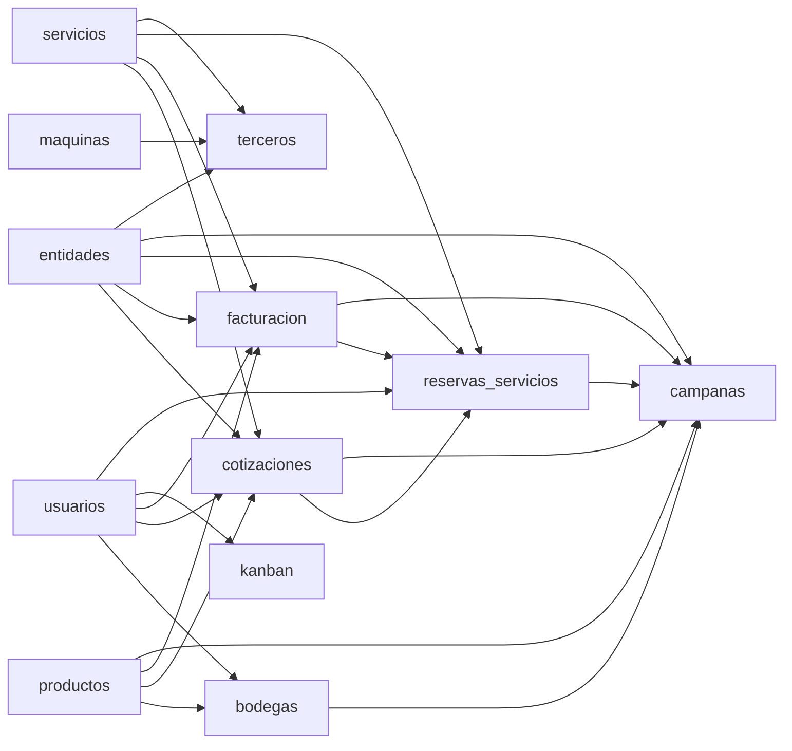

# Funcionalidades y módulos de coreEngine

Documento de funcionalidades de la plataforma: catálogo único de módulos (funcional y técnico) y dependencias entre módulos.

---

## Tabla de contenidos

- [Módulos](#módulos)
- [Dependencias entre módulos](#dependencias-entre-módulos)
- [Orden de instalación sugerido](#orden-de-instalación-sugerido)
- [Otras dependencias](#otras-dependencias)
- [Documentación relacionada](#documentación-relacionada)

---

## Módulos

Un módulo es una carpeta autocontenida en `admin/app/modules/`: aporta sus controladores, vistas, installer, pruebas y, si aplica, widgets y funciones internas.

### Mapa funcional

Qué módulo ve el usuario, en qué carpeta vive, qué resuelve y de qué depende.

**Módulos de negocio.** El nombre funcional es el que aparece en el menú; la carpeta es la que existe en el repositorio.

| Módulo funcional | Carpeta(s) | Qué resuelve | Depende de |
|---|---|---|---|
| **Gestión de usuarios** | `usuarios` | Usuarios, asignación de permisos y niveles de acceso a cada módulo. Módulo instalado por defecto. | — |
| **Gestión de proyectos** | `kanban` | Proyectos con tablero kanban: tableros, etapas y tareas, con descripciones libres o tareas predeterminadas configuradas en otra transacción. | `usuarios` |
| **Documentos mercantiles** | `facturacion` | Órdenes de compra, guías de despacho, facturas, notas de crédito y débito, y estados de pago. Integra el SII mediante Libre DTE (API externa). | `usuarios`, `entidades`, `productos`, `servicios` |
| **Bodegas y productos** | `bodegas` + `productos` | Stock, ingreso/egreso y movimiento de productos entre bodegas; catálogo de productos. | `bodegas` → `usuarios`, `productos`. `productos` → sin dependencias. |
| **Entidades** | `entidades` | Personas y empresas, contactos, cargas, documentos y observaciones. Pensado para ser usado por los demás módulos. | — |
| **Máquinas** | `maquinas` | Equipos, componentes, documentos, sensores y alarmas. | — |
| **Servicios y cotizaciones** | `servicios` + `cotizaciones` | Catálogo de servicios y cotizaciones con ítems, productos y servicios. | `cotizaciones` → `usuarios`, `entidades`, `productos`, `servicios`. `servicios` → sin dependencias. |
| **Reservas de espacios** | `reservas_espacios` | Espacios, solicitantes, recursos, disponibilidad y solapamiento. Referencia de reglas de disponibilidad. | `usuarios` (JOIN a `usuarios_listado`). |
| **Reservas de servicios** | `reservas_servicios` | Agenda, bloqueos, cobertura, tarifas, promociones y solicitudes de servicios. | `usuarios`, `entidades`, `servicios`, `cotizaciones`, `facturacion` |
| **Campañas** | `campanas` | Campañas de venta: partidas, costos, pérdidas, pagos, cobranza y análisis. | `entidades`, `productos`, `bodegas`, `facturacion`, `cotizaciones`, `reservas_servicios` |
| **Terceros** | `terceros` | Entidades terceras con máquinas, planes y usuarios. | `entidades`, `servicios`, `maquinas` |
| **Vehículos** | `vehiculos` | Flota de vehículos, documentos y observaciones. | — |
| **Tokens y OAuth (MCP)** | `tokens_listado` | Tokens de acceso, clientes OAuth y accesos OAuth del servidor MCP. | — |

**Módulos de soporte.** No son módulos de negocio, pero forman parte del esqueleto de la aplicación.

| Módulo | Carpeta | Qué resuelve |
|---|---|---|
| **Principal y autenticación** | `main` | Login, recuperación de contraseña, pantalla principal con widgets y perfil. |
| **Archivos** | `archivos` | Explorador de archivos con widget `fileExplorer` y `ScopeAccess`; sin tablas propias. |
| **Sistema** | `sistema` | Datos y opciones de la empresa y del sistema. |
| **Inteligencia artificial** | `IA_module` | Consultas asistidas por IA sobre la base de datos y documentos. |
| **Instalador** | `installer` | Instalación inicial de la plataforma (`admin/app/utils/installer.php`, scripts `files/*.sql`). |
| **Maquetación** | `root_maquetacion` | Demostraciones de UI; solo superadmin. |
| **Plataforma** | `root_plataforma` | Plantillas CRUD de referencia, permisos, instalación de módulos, runner de pruebas y opciones de plataforma; solo superadmin. |

## Dependencias entre módulos

Cada installer declara sus dependencias en `ListDataModule()`. El instalador las verifica antes de instalar y `InstallModule` es idempotente (ADR-0013): se puede re-ejecutar como "Actualizar Módulo" sin perder datos.

### Dependencias declaradas

| Módulo | Depende de |
|---|---|
| `bodegas` | `usuarios`, `productos` |
| `campanas` | `entidades`, `productos`, `bodegas`, `facturacion`, `cotizaciones`, `reservas_servicios` |
| `cotizaciones` | `usuarios`, `entidades`, `productos`, `servicios` |
| `facturacion` | `usuarios`, `entidades`, `productos`, `servicios` |
| `kanban` | `usuarios` |
| `reservas_servicios` | `usuarios`, `entidades`, `servicios`, `cotizaciones`, `facturacion` |
| `terceros` | `entidades`, `servicios`, `maquinas` |

### Orden de instalación sugerido

Derivado de la tabla anterior; sirve para no dejar dependencias sin resolver al instalar o actualizar.

1. **Sin dependencias declaradas:** `usuarios`, `productos`, `servicios`, `entidades`, `maquinas`, `vehiculos`, `tokens_listado`, `sistema`, `archivos`, `main`, `root_maquetacion`, `root_plataforma`, `IA_module`, `installer`.
2. **Sobre esa base:** `bodegas`, `cotizaciones`, `facturacion`, `kanban`, `terceros`, `reservas_espacios` (solo requiere `usuarios`).
3. **Después:** `reservas_servicios`.
4. **Al final:** `campanas`.

### Otras dependencias

- `reservas_espacios` → `usuarios` (JOIN contra `usuarios_listado`).
- `campanas` enruta controladores de `facturacion` (`gestionDocumentos->View_1/View_2`, `gestionDocumentosPagos->*`) y de `bodegas` (`bodegasMovimiento->View_2`).
- `reservas_servicios` → `vendors/application/functions/FunctionsReservaServicios.php` (ADR-0010, que sustituye a ADR-0005).
- Todos los módulos → tablas `core_*` (`core_estados`, `core_ubicacion_*`, `core_permisos_*`, `core_sistemas`).

---

## Documentación relacionada

- [README.md](README.md) — visión general, demo, SDD y reglas.
- [AGENTES.md](AGENTES.md) — agents, skills, specs y tasks.
- [ARCHITECTURE.md](ARCHITECTURE.md) — arquitectura, componentes de seguridad y capa de datos.
- [DATABASE.md](DATABASE.md) — modelo de datos y diagrama ER.
- [FEATURES.md](FEATURES.md) — funcionalidades y módulos con capturas.
- [INSTALLATION.md](INSTALLATION.md) — requisitos, instalación y configuración.
- [OPERATIONS.md](OPERATIONS.md) — escalabilidad, cambios, backups y DRP.
- [SECURITY.md](SECURITY.md) — modelo de seguridad, permisos y niveles de acceso.
