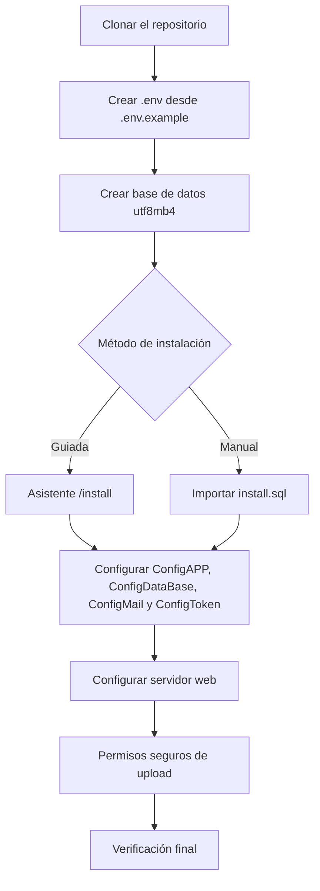

# Guía de instalación y configuración

Instrucciones para la configuración inicial, importación de base de datos y despliegue seguro de **coreEngine**.

---

## Tabla de contenidos

- [Requisitos del sistema](#requisitos-del-sistema)
- [Flujo de instalación](#flujo-de-instalación)
- [1. Obtener el código](#1-obtener-el-código)
- [2. Crear la base de datos](#2-crear-la-base-de-datos)
- [3. Instalación guiada](#3-instalación-guiada)
- [4. Importación manual de la base de datos](#4-importación-manual-de-la-base-de-datos)
- [5. Configuración de la aplicación](#5-configuración-de-la-aplicación)
- [6. Configuración del servidor web](#6-configuración-del-servidor-web)
- [7. Permisos seguros de `upload`](#7-permisos-seguros-de-upload)
- [8. Verificación final](#8-verificación-final)
- [9. Troubleshooting](#9-troubleshooting)

---

## Requisitos del sistema

- **Servidor web:** Apache 2.4+ o Nginx, con reescritura de URLs (`mod_rewrite`) habilitada.
- **PHP:** 8.4 recomendado (runtime actual `lamp-php84`, 8.4.27). Mínimo 8.0; la exportación `.xlsx` requiere PHP ≥ 8.3.
- **Base de datos:** MySQL 5.7+ / MariaDB 10.3+. Soporte opcional de PostgreSQL, SQLite, MongoDB y Jig.
- **Redis:** opcional, para caché y sesiones distribuidas.
- **Extensiones PHP:**
  - `pdo`, `pdo_mysql`: conexión y gestión de la base de datos.
  - `gd`: procesamiento, redimensionado y recorte de imágenes.
  - `curl`: integraciones HTTP, mail y APIs externas.
  - `mbstring`: cadenas multibyte y UTF-8.
  - `openssl`: cifrado y generación de tokens.
  - `json`: respuestas JSON y JWT.
  - `fileinfo`: validación de tipos MIME en la subida de archivos.
  - Exportación a Excel: `ctype`, `dom`, `filter`, `iconv`, `libxml`, `simplexml`, `xml`, `xmlreader`, `xmlwriter`, `zip`, `zlib`.

---

## Flujo de instalación



---

## 1. Obtener el código

```bash
git clone https://github.com/tenshi98/coreEngine.git
cd coreEngine
```

No se ejecuta Composer para la aplicación: el autoload lo arma F3 con `AUTOLOAD`. Las librerías Office de `vendors/libs/` ya vienen vendorizadas.

Copia el archivo de entorno y ajusta los valores:

```bash
cp admin/app/config/.env.example admin/app/config/.env
```

Variables principales de `.env`:

| Grupo | Variables |
|---|---|
| Software | `SOFTWARE_NAME`, `SOFTWARE_SLOGAN`, `SOFTWARE_COMPANYNAME`, `SOFTWARE_COMPANYEMAIL`, `SOFTWARE_COMPANYCREDITS`, `SOFTWARE_URL`, `SOFTWARE_MAINFOLDER` |
| Base de datos | `DB_ADMIN_*`, `DB_MYSQL1_*`, `DB_MCP_*`, `DB_POSTGRES1_*`, `DB_SQLITE1_ROUTE`, `DB_MONGO1_*`, `DB_JIG1_ROUTE`, `DB_REDIS1_ROUTE` |
| Almacenamiento S3 | `S3_KEY`, `S3_SECRET`, `S3_REGION`, `S3_BUCKET`, `S3_PREFIX`, `S3_ENDPOINT` |
| Almacenamiento GCS | `GCS_PROJECT_ID`, `GCS_BUCKET`, `GCS_PREFIX` |
| Almacenamiento SFTP | `SFTP_HOST`, `SFTP_PORT`, `SFTP_USER`, `SFTP_PASSWORD`, `SFTP_KEY_PASS`, `SFTP_BASE_PATH`, `SFTP_BASE_URL` |
| Exportación | `MAX_EXPORT_ROWS` (por defecto `20000`, techo `100000`; variable opcional, no incluida en `.env.example`) |

> `ConfigAPP.php` y `ConfigDataBase.php` resuelven sus valores desde `.env` mediante `EnvLoader.php`. No escribas credenciales directamente en el código si puedes usar `.env`.

---

## 2. Crear la base de datos

Conéctate a MySQL/MariaDB con tu gestor preferido (phpMyAdmin, DBeaver, MySQL Workbench) o por terminal y crea la base de datos vacía con cotejamiento `utf8mb4`:

```sql
CREATE DATABASE IF NOT EXISTS `core_engine`
  CHARACTER SET utf8mb4
  COLLATE utf8mb4_unicode_ci;
```

---

## 3. Instalación guiada

coreEngine incluye un asistente web en `/install` con cinco pasos:

| Paso | Ruta | Qué hace |
|---|---|---|
| 1 | `GET /install` | Bienvenida y validación de instalación. |
| 2 | `GET/POST /install/credentials` | Credenciales MySQL. |
| 3 | `GET/POST /install/database` | Configuración de la base de datos. |
| 4 | `GET/POST /install/summary` | Resumen de lo configurado. |
| 5 | `GET/POST /install/finish` | Finalización. |

Las rutas del instalador están exentas de CSRF en `ConfigAPP::APP['csrfExcludeRoutes']` porque no hay sesión de usuario.

Si la instalación ya está hecha, el asistente no permite reinstalar (`ValidInstall = false`).

---

## 4. Importación manual de la base de datos

Si prefieres no usar el asistente, importa el esquema base:

- **Archivo:** `admin/app/modules/installer/files/install.sql`
- **Migración opcional:** `admin/app/modules/installer/files/migracion_observaciones_creador_editor.sql`

### Vía terminal

```bash
mysql -u [usuario_mysql] -p core_engine < admin/app/modules/installer/files/install.sql
```

### Vía Docker

```bash
docker exec -i [nombre_o_id_contenedor_mysql] \
  mysql -u root -p[contraseña] core_engine \
  < admin/app/modules/installer/files/install.sql
```

### Vía phpMyAdmin

1. Accede a phpMyAdmin y selecciona la base de datos `core_engine`.
2. Abre la pestaña **Importar**.
3. Selecciona `admin/app/modules/installer/files/install.sql`.
4. Pulsa **Continuar**.

> `install.sql` crea las tablas base del núcleo. Cada módulo crea sus propias tablas, índices, permisos y rutas desde su `installer/` al instalarse o actualizarse (ADR-0013: instalador idempotente).

---

## 5. Configuración de la aplicación

### 5.1 `ConfigAPP.php`

Ubicación: `admin/app/config/ConfigAPP.php`

**Datos del software (`const SOFTWARE`):**

| Parámetro | Descripción |
|---|---|
| `SoftwareName` | Nombre comercial de la aplicación. |
| `SoftwareSlogan` | Slogan del software. |
| `CompanyName` | Razón social de la compañía. |
| `CompanyEmail` | Correo corporativo. |
| `CompanyCredits` | Créditos. |
| `URL` | **[CRÍTICO]** URL pública absoluta, con protocolo y barra final. Ejemplo: `https://mi-dominio.com/`. |

**Parámetros generales (`const APP`):**

| Parámetro | Descripción | Valor actual |
|---|---|---|
| `N_MaxItems` | Número máximo de registros sin paginar. | `2500` |
| `N_MaxExportRows` | Filas máximas de una exportación a Excel (env `MAX_EXPORT_ROWS`). Se acota entre `N_MaxItems` y `100000`. | `20000` |
| `checkBruteConections` | Intentos de login fallidos antes de banear temporalmente la IP (5 horas). | `5` |
| `checkBruteMaxConections` | Reincidencias antes de enviar la IP a la lista negra del servidor. | `20` |

**Almacenamiento (`uploadServer`):**

| Valor | Driver | Configuración |
|---|---|---|
| `local` | Disco del servidor | `uploadFolder` (ruta absoluta), `uploadUrl` (URL pública base). |
| `s3` | Amazon S3 o compatible (MinIO, DigitalOcean Spaces, Cloudflare R2, Backblaze B2, Wasabi) | `s3Key`, `s3Secret`, `s3Region`, `s3Bucket`, `s3Prefix`, `s3Endpoint`, `s3Acl`, `s3UrlSigned`, `s3UrlExpiry`. |
| `gcs` | Google Cloud Storage | `gcsProjectId`, `gcsKeyFile`, `gcsBucket`, `gcsPrefix`, `gcsUrlSigned`, `gcsUrlExpiry`. |
| `sftp` | Servidor remoto SFTP/SSH | `sftpHost`, `sftpPort`, `sftpUser`, `sftpPassword` o `sftpPrivateKey`, `sftpBasePath`, `sftpBaseUrl`, `sftpTimeout`. |

**Seguridad (`const APP`):**

| Parámetro | Descripción |
|---|---|
| `auditLoggerPath` | Ruta base de los archivos de auditoría. |
| `rateLimiterFileIP` | Archivo de rate limit por IP. |
| `rateLimiterFileUser` | Archivo de rate limit por usuario. |
| `rateLimiterGuestMaxAttempts` / `rateLimiterGuestWindowSeconds` | Límite para usuarios desconocidos (20 intentos / 60 s). |
| `rateLimiterUserMaxAttempts` / `rateLimiterUserWindowSeconds` | Límite para usuarios logueados (240 intentos / 480 s). |
| `errorLogFile` | Archivo de errores. |
| `csrfEnabled` | Activa la validación CSRF. |
| `csrfTokenName` | Campo POST del token (`_token`). |
| `csrfHeaderName` | Cabecera AJAX del token (`X-CSRF-Token`). |
| `csrfExcludeVerbs` | Verbos exentos (`GET`, `HEAD`, `OPTIONS`). |
| `csrfExcludeRoutes` | Rutas exentas (instalador `/install/*`). |

### 5.2 `ConfigDataBase.php`

Ubicación: `admin/app/config/ConfigDataBase.php`

Define las conexiones a los motores soportados. Cada clave toma sus valores de `.env`:

| Constante | Motor | Campos |
|---|---|---|
| `MySQL_ADMIN` | MySQL principal (administración) | `HOSTNAME`, `USERNAME`, `PASSWORD`, `DATABASE`, `CHARSET`, `PORT` |
| `MySQL_1` | MySQL de la aplicación | `HOSTNAME`, `USERNAME`, `PASSWORD`, `DATABASE`, `CHARSET`, `PORT` |
| `MySQL_MCP` | MySQL de solo lectura del MCP | `HOSTNAME`, `USERNAME`, `PASSWORD`, `DATABASE`, `CHARSET`, `PORT` |
| `PostGreSQL_1` | PostgreSQL | `HOSTNAME`, `USERNAME`, `PASSWORD`, `DATABASE`, `PORT` |
| `SQLite_1` | SQLite | `ROUTE` (ruta absoluta al archivo `.sqlite`) |
| `MongoDB_1` | MongoDB | `HOST`, `DATABASE` |
| `Jig_1` | Jig (BD ligera en disco) | `ROUTE` |
| `Redis_1` | Redis | `ROUTE` |

Recomendaciones:

- `HOSTNAME`: `localhost`, `127.0.0.1` o el nombre del contenedor Docker (por ejemplo `database`).
- `USERNAME`: usuario con permisos de lectura/escritura/DDL.
- `CHARSET`: `utf8mb4`.
- `PORT`: `3306` para MySQL.

### 5.3 `ConfigMail.php`

Ubicación: `admin/app/config/ConfigMail.php`

| Perfil | Campos |
|---|---|
| `SMTPSender` | `SERVERURL`, `SERVERPORT` (465 SSL / 587 TLS), `SERVERSECURE` (`SSL`/`TLS`), `USEREMAIL`, `USERNAME`, `PASSWORD` |
| `GmailSender` | `SERVERURL` (`smtp.gmail.com`), `SERVERPORT` (`465`), `SERVERSECURE` (`SSL`), `USEREMAIL`, `USERNAME`, `PASSWORD` (contraseña de aplicación de Google) |
| `SendingBlueSender` | `SERVERURL` (`https://api.brevo.com/v3/smtp/email`), `SERVERAPI` (API Key v3 de Brevo/Sendinblue) |

Los valores se cargan desde `.env` (`MAIL_SMTP_*`, `MAIL_GMAIL_*`, `MAIL_SENDINGBLUE_*`). Se usa para notificaciones, recuperación de contraseñas y avisos del sistema.

### 5.4 `ConfigToken.php`

Ubicación: `admin/app/config/ConfigToken.php`

Contiene dos bloques:

**`const JWT`:**

| Parámetro | Descripción |
|---|---|
| `TOKEN_AUTHENTICATION` | `true` / `false`: activa o desactiva la autenticación por token. |
| `SECRET_KEY` | Clave secreta para el cifrado de tokens (env `JWT_SECRET_KEY`). |
| `TIME_TO_LIVE` | Tiempo de vida del token en segundos (`86400` por defecto). |

**`const ENCODE_KEYS`:**

| Parámetro | Descripción |
|---|---|
| `KEY_1` … `KEY_11` | Claves de cifrado en capas para proteger comunicaciones y peticiones sensibles (env `ENCODE_KEY_1` … `ENCODE_KEY_11`). `KEY_1` se usa para uso interno. |

---

## 6. Configuración del servidor web

Los archivos `.htaccess` ya están incluidos. Asegúrate de que la reescritura esté habilitada.

### Apache

```bash
sudo a2enmod rewrite
sudo service apache2 restart
```

El `DocumentRoot` debe apuntar a `admin/public/` (o al `public/` del sitio correspondiente). Verifica que `AllowOverride All` esté permitido para esa ruta.

### Nginx

Configura el `root` al directorio `public/` correspondiente y redirige las peticiones al `index.php`:

```nginx
location / {
    try_files $uri $uri/ /index.php?$query_string;
}
```

---

## 7. Permisos seguros de `upload`

Directorio: `admin/public/upload` (y el `upload/` de cada sitio público que lo use).

> [!CAUTION]
> **NUNCA asignes permisos `777` (`chmod -R 777`) en producción.** Permite que cualquier usuario o proceso modifique o inyecte código ejecutable.

### Linux

1. Asigna la propiedad al usuario del servidor web (`www-data` en Ubuntu/Debian; `apache`/`nginx` en RHEL/CentOS):

```bash
sudo chown -R www-data:www-data admin/public/upload
```

2. Directorios a `755`:

```bash
sudo find admin/public/upload -type d -exec chmod 755 {} \;
```

3. Archivos a `644`:

```bash
sudo find admin/public/upload -type f -exec chmod 644 {} \;
```

### Protección contra ejecución de scripts (Apache)

En `admin/public/upload/.htaccess`:

```apache
<FilesMatch "\.(php|php3|php4|php5|phtml|pl|py|jsp|asp|sh|cgi)$">
    Require all denied
</FilesMatch>
php_flag engine off
```

### Protección contra ejecución de scripts (Nginx)

En el archivo de configuración del sitio, dentro del bloque `server`:

```nginx
location ~ ^/upload/.*\.php$ {
    deny all;
    return 404;
}
```

---

## 8. Verificación final

1. Comprueba la sintaxis de los archivos de configuración:

```bash
php -l admin/app/config/ConfigAPP.php
php -l admin/app/config/ConfigDataBase.php
php -l admin/app/config/ConfigMail.php
php -l admin/app/config/ConfigToken.php
```

2. Accede a la URL de la aplicación desde el navegador.
3. Comprueba el inicio de sesión y la subida de un archivo de prueba.
4. Revisa que `admin/security/` tenga permisos de escritura para `rateLimit_IP.json`, `rateLimit_User.json`, auditoría y `error.log`.
5. Verifica que las rutas de los módulos instalados aparezcan según los permisos del usuario.

---

## 9. Troubleshooting

### "Error al conectar con MySQL"

- Verifica que MySQL esté corriendo.
- Verifica que la base de datos exista.
- Verifica permisos del usuario.

```bash
mysql -u root -p -e "SHOW DATABASES;"
mysql -u root -p -e "GRANT ALL ON core_engine.* TO 'tu_usuario'@'localhost';"
```

### 404 o página vacía

La ruta no está en `admin/app/utils/*.php` ni en `SESSION.arrPermisos`: el permiso no está asignado o el módulo no está instalado.

### 419 al enviar un formulario

Falta el token CSRF. Comprueba que el formulario envíe `_token` o la cabecera `X-CSRF-Token`. El JS reintenta automáticamente con el token nuevo (`functions_v2.js`).

### 429 Too Many Requests

Se superó el rate limit por IP o por usuario. Revisa `admin/security/rateLimit_IP.json` y `admin/security/rateLimit_User.json`, y los límites de `ConfigAPP::APP`.

### 503 al exportar a Excel

Falta alguna extensión PHP exigida por `FunctionsExportExcel::missingExtensions()`. El detalle queda en `error_log`.

### 500 o error interno

Revisa `admin/security/error.log` y el log del servidor web. `ErrorHandler` registra el detalle.

---

## Documentación relacionada

- [README.md](README.md) — visión general, demo, SDD y reglas.
- [AGENTES.md](AGENTES.md) — agents, skills, specs y tasks.
- [ARCHITECTURE.md](ARCHITECTURE.md) — arquitectura, componentes de seguridad y capa de datos.
- [DATABASE.md](DATABASE.md) — modelo de datos y diagrama ER.
- [FEATURES.md](FEATURES.md) — funcionalidades y módulos con capturas.
- [INSTALLATION.md](INSTALLATION.md) — requisitos, instalación y configuración.
- [OPERATIONS.md](OPERATIONS.md) — escalabilidad, cambios, backups y DRP.
- [SECURITY.md](SECURITY.md) — modelo de seguridad, permisos y niveles de acceso.
